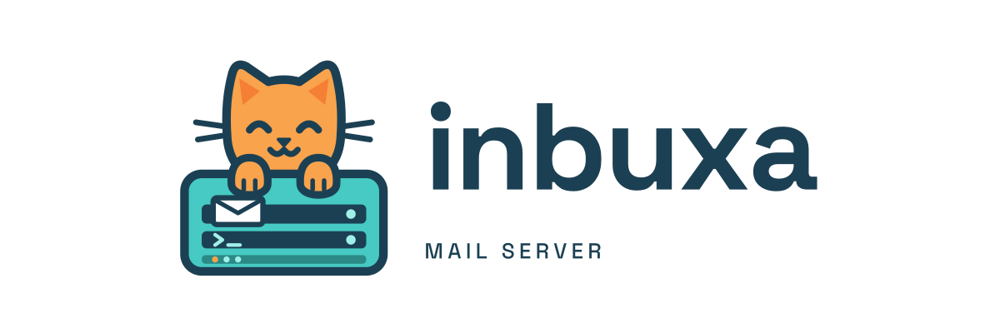

  

<h3 align="center">
  inbuxa on Kubernetes: the Helm chart
</h3>

  
  
  
  

---

> [!NOTE]
> Development happens on [git.coffeylabs.org/inbuxa/inbuxa-charts](https://git.coffeylabs.org/inbuxa/inbuxa-charts); the copy on GitHub is a read-only mirror.
> Report issues at **[git.coffeylabs.org/inbuxa/inbuxa-charts/issues](https://git.coffeylabs.org/inbuxa/inbuxa-charts/issues)**, join discussions at **[community.coffeylabs.org](https://community.coffeylabs.org)**, or chat on **[Discord](https://discord.gg/nqcY4TKfAn)**.

> [!WARNING]
> **Release candidates.** The chart's releases, from `27.1.0-rc.1`, are
> release candidates for inbuxa 27.1: for test clusters and test domains,
> not live mail. The install guide is on
> [docs.inbuxa.org](https://docs.inbuxa.org/kubernetes/), with a page on
> [testing a release candidate](https://docs.inbuxa.org/kubernetes/testing/).

The Helm chart for running **inbuxa** on Kubernetes: the mail server, the
[webmail](https://git.coffeylabs.org/inbuxa/inbuxa-webmail) and the
[console](https://git.coffeylabs.org/inbuxa/inbuxa-admin), against a
PostgreSQL, NATS and S3 you provide. Every release is signed and pins its
images by digest; see [Releases](#releases). The chart is tested end to end
in [inbuxa-k8s-lab](https://git.coffeylabs.org/inbuxa/inbuxa-k8s-lab).

## In this repository

- `charts/inbuxa`: the chart, its values schema and its tests
- `tools/check.sh`: every check CI runs; see [CONTRIBUTING.md](CONTRIBUTING.md)
- [CHANGELOG.md](CHANGELOG.md)

## Security defaults

Every pod passes Pod Security "restricted" in enforce mode: non-root, every
capability dropped, no privilege escalation, a read-only root filesystem,
the RuntimeDefault seccomp profile. No pod gets a service-account token except
the upgrade Job, which scales the server down for a layout change through a
Role that only it holds. Secrets reach the pods as mounted files, never as
values or environment variables.

The server writes to two emptyDirs and nowhere else:

| Path | What's written there |
|---|---|
| `/tmp` | application bundles, unpacked when an Application is installed |
| `/var/lib/inbuxa` | the working directory: a migration's work files, under `migrations/` |

Both go with the pod, which is all they need. `config.json` is a read-only
mount of `server.dataStore`, so the data store settings can't be saved in
the console: they change through the chart's values instead.

NetworkPolicies are on by default (`networkPolicy`) and need a CNI that
enforces them. Every pod starts from deny all, in and out:

| Pods | In | Out |
|---|---|---|
| server | its mail listeners and `https` from anywhere; `http` from `networkPolicy.httpFrom` and the webmail (anywhere when `httpFrom` is empty) | anywhere, or DNS plus `networkPolicy.serverEgress` |
| seed and upgrade Jobs | nothing | as the server |
| webmail | 8080 from `networkPolicy.httpFrom` (anywhere when empty) | DNS, the server's `http` port, and TCP 80 and 443 anywhere for remote images and calendars (`networkPolicy.webmailInternet`) |
| console | 8080 from `networkPolicy.httpFrom` (anywhere when empty) | nothing: the browser calls the server |

The kubelet's probes come from the node, which NetworkPolicy always allows.

## Releases

A tag `v27.1-rc.N` releases chart `27.1.0-rc.N` (`.github/workflows/release.yml`,
run on the GitHub mirror for its keyless signing). It pins the server, webmail
and console images named in `release/suite.yaml` by digest, after checking
each one's signature; pushes the chart to `oci://ghcr.io/inbuxa/charts` and
the Gitea registry, signed with cosign; and puts rendered manifests and a
minisign-signed `SHA256SUMS` on the release page.

    tools/verify-release.sh 27.1.0-rc.1

checks a release as someone installing it would: the chart's signature, the
checksums and their signature, and every pinned image's signature.

Installs on real clusters, the mail tests and the upgrade tests are in
[inbuxa-k8s-lab](https://git.coffeylabs.org/inbuxa/inbuxa-k8s-lab). The guide
is at [docs.inbuxa.org](https://docs.inbuxa.org/).

## License

The chart is free software under the [Apache License 2.0](LICENSE), and a
Coffey Labs project. The images it runs are licensed separately: the server,
the webmail and the console are under the AGPL-3.0, as their own
repositories say.
